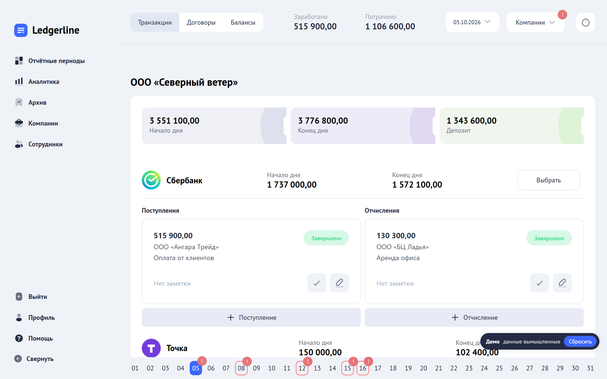
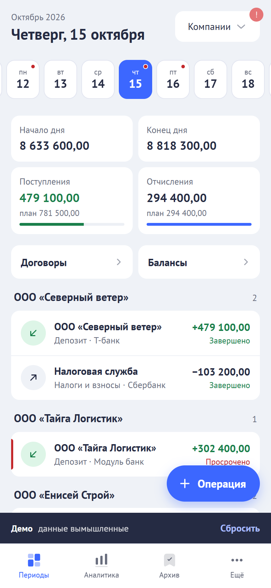
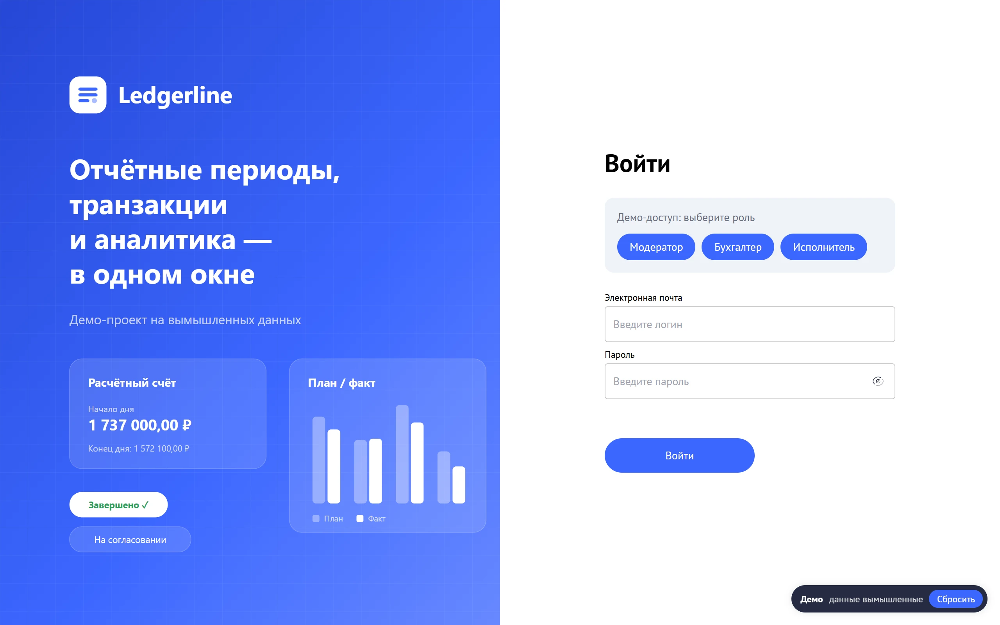
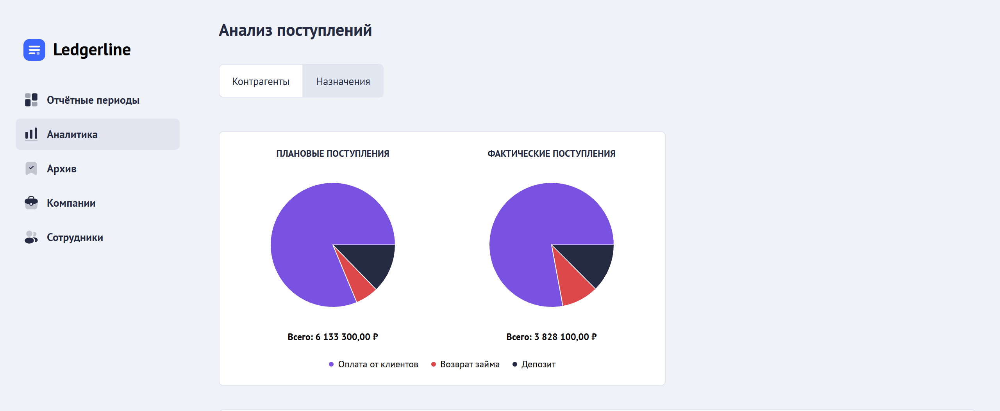
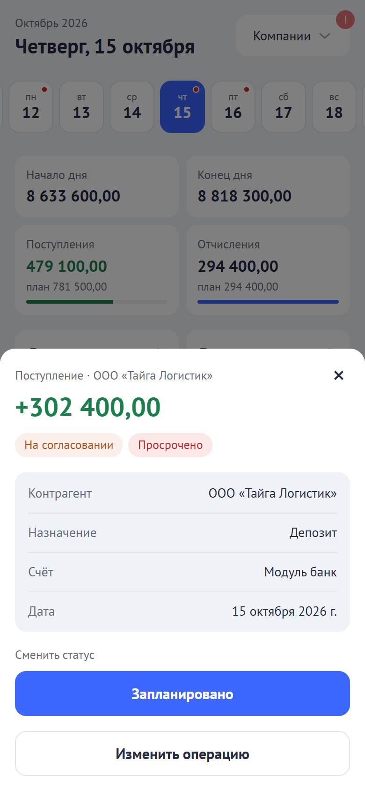

# Ledgerline

Веб-приложение для финансовой отчётности. Отчётный месяц разбит по дням, по счетам компаний ведутся поступления и отчисления со статусами и просрочками, а итоги видны как план и факт.

Это демо коммерческого проекта: название, данные и контакты изменены, все цифры вымышленные.

**[Открыть демо →](https://slava-makeenko.github.io/ledgerline-demo/)**: вход под ролью в один клик, backend не нужен, работает и на телефоне.

<p align="center">
  
  &nbsp;
  
</p>

## Что посмотреть за две минуты

1. На экране входа выберите роль: «Модератор», «Бухгалтер» или «Исполнитель».
2. Откройте текущий месяц. На экране видны компании, счета, начало и конец дня, депозит. Дни с просроченными операциями отмечены в ленте внизу.
3. Смените статус операции или отредактируйте её. Можно выбрать несколько операций и изменить их одним действием.
4. Откройте аналитику: план и факт поступлений и отчислений по контрагентам и назначениям.
5. Откройте ту же ссылку с телефона. Там вместо таблиц экран дня, лента операций и шторка с действиями.

Изменения хранятся до закрытия вкладки. Кнопка «Сбросить» возвращает исходные данные.

## Возможности

- **Отчётные периоды.** Месяц по дням, стартовые балансы и депозит, дедлайны для исполнителей, архив закрытых периодов.
- **Операции.** Поступления и отчисления по счетам, статусы «На согласовании → Запланировано → Завершено», просрочки. Массовые действия: смена статуса и даты, удаление.
- **Балансы и договоры.** Остатки по счетам и депозитам, договоры с контрагентами и платежи по ним.
- **Аналитика.** План и факт за период, круговые и столбчатые диаграммы, фильтры по компаниям, контрагентам и назначениям, работа с депозитами.
- **Справочники.** Компании, контрагенты, назначения платежей, сотрудники.

| Роль        | Что может                                                                                          |
| ----------- | -------------------------------------------------------------------------------------------------- |
| Модератор   | Видит все компании и разделы, ведёт справочники и сотрудников, согласует операции, задаёт дедлайны |
| Бухгалтер   | Работает с операциями своих компаний и отмечает их исполнение                                      |
| Исполнитель | Видит свои компании, добавляет и правит операции до дедлайна, статусы не меняет                    |

<table>
  <tr>
    <td width="50%"><br><sub>Вход: роль в один клик</sub></td>
    <td width="50%"><br><sub>Аналитика: план и факт</sub></td>
  </tr>
</table>

## Мобильная версия

<table>
  <tr>
    <td width="34%"></td>
    <td>
      Мобильная версия устроена по-своему, а не повторяет десктоп в уменьшенном виде.
      <ul>
        <li>Вместо бокового меню — нижние вкладки и шторка «Ещё».</li>
        <li>Отчётный период превращается в экран дня. Наверху лента дней с метками просрочек, под ней сводка «начало и конец дня, поступления и отчисления к плану», ниже операции по компаниям.</li>
        <li>Операция открывается в шторке. В ней можно сменить статус и отредактировать операцию, права те же, что на десктопе. Новая операция добавляется кнопкой «Операция».</li>
        <li>Модалки открываются нижними шторками, кнопки и поля не меньше 44 px, поля ввода 16 px, чтобы iOS не увеличивал страницу.</li>
        <li>Массовые действия, стартовые балансы, депозит и дедлайны остаются на десктопе.</li>
      </ul>
      На планшете меню свёрнуто до иконок. Анимации короткие (150–250 мс) и отключаются системной настройкой «Уменьшить движение».
    </td>
  </tr>
</table>

## Технические решения

1. **Демо без backend на MSW.** Запросы перехватываются в браузере через service worker, а API-слой и хранилища остались прежними. Если service worker не регистрируется (так бывает во встроенных браузерах мессенджеров), запросы перехватываются прямо на странице через `@mswjs/interceptors`.

   Демо-база лежит в `sessionStorage`. Запросы вне демо-сценариев получают ответ 403. Демо-API находится на том же домене, поэтому даже без MSW запрос не уйдёт на рабочий сервер. В обычную сборку код демо не попадает.

2. **Публикация только сборки.** Сайт собирается под путь `/ledgerline-demo/`: роутер, адрес service worker и демо-API берут его из `BASE_URL`, а `404.html` открывает прямые ссылки на внутренние страницы. Перед публикацией сборка проверяется: в ней не должно быть реальных адресов, email и source maps.
3. **Одни правила для десктопа и телефона.** Правила смены статуса и расчёт итогов дня вынесены в чистые функции. Их используют и карточка компании на десктопе, и мобильный экран дня, поэтому права и суммы не расходятся.
4. **Адаптив и движение как система.** Брейкпоинты и миксины задаются в одном месте. Высоту кнопок 44 px задают сами миксины кнопок. Анимации используют общие токены длительности, а `prefers-reduced-motion` отключает их глобально. Вёрстку проверяет скрипт на 10 экранах при ширине 320, 375, 768 и 1280 px. Он ищет горизонтальную прокрутку, текст, вылезающий из кнопок, и мелкие цели касания.

## Стек

React 19 · TypeScript 5.7 · Vite 6 · React Router 7 · Zustand 5 · Axios · Recharts 2 · date-fns 4 · SCSS · MSW 2 · ESLint 9 · Prettier 3

## Архитектура

Слои в духе Feature-Sliced Design:

```
src/
  app/        bootstrap, роутинг, глобальные стили, демо-режим (app/demo)
  pages/      экраны: вход, периоды, период, балансы, договоры, аналитика, справочники
  widgets/    составные блоки: меню и нижние вкладки, карточка компании, экран дня
  features/   действия пользователя: модалки операций и справочников, фильтры, графики
  entities/   сущности: типы, запросы к API, хранилища Zustand
  shared/     UI-кит, API-клиент, хуки, стили и токены, утилиты
```

## Об этом репозитории

Здесь лежит только собранное демо для GitHub Pages: `index.html`, `assets/`, `404.html` для прямых ссылок и `mockServiceWorker.js`, плюс этот README со скриншотами. Исходный код находится в приватном репозитории. Сборку получают из исходников командой `yarn build:pages` и публикуют сюда без изменений.

## Проверки

- ESLint проходит без ошибок. Предупреждения остаются, в основном это `console.error` в обработчиках ошибок.
- TypeScript проверяется без ошибок, и сборка не запускается, пока проверка типов не пройдёт.
- Вёрстку проверяет скрипт на 10 экранах при ширине 320, 375, 768 и 1280 px.
- Сценарии трёх ролей проверены вручную в браузере, на десктопе и в мобильной вёрстке.

## Ограничения

- Автотестов пока нет, Vitest и Playwright запланированы.
- TypeScript работает без строгого режима, в аналитике встречается `any`.
- Границы слоёв FSD соблюдаются не везде: часть бизнес-логики живёт в виджетах.
- В демо данные хранятся до закрытия вкладки. Действия вне демо-сценариев отвечают «Недоступно в демо-режиме».
- Тёмной темы нет.

## Мой вклад

- **Исходный проект (2025–2026).** Фронтенд финансового кабинета для заказчика, с первого коммита: структура слоёв, экраны периодов и операций, массовые действия, аналитика, ролевой доступ, API-слой. Backend — отдельный сервис, в демо его заменяет MSW.
- **Демо-версия (октябрь 2026).**
  - Подготовил репозиторий: убрал секреты из git, исправил 62 ошибки TypeScript, добавил проверку типов в сборку.
  - Сделал демо-режим на MSW и ребрендинг.
  - Сделал мобильную версию и опубликовал демо.
  - Работал вместе с AI-агентом по контракту репозитория: план, ADR, реализация, проверка в браузере.
